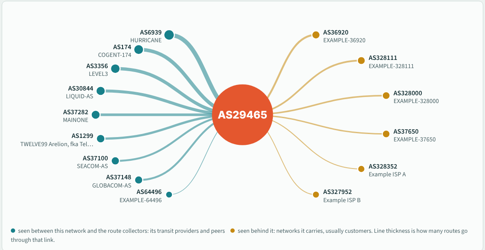

# asnscope

Type an AS number, IP address or prefix. See what that network announces to the internet and which networks sit on either side of it in BGP. Built for exploring African networks, works for any AS on earth.

**Live: https://greatslab.github.io/asnscope/**


*(the screenshot uses mock data from the browser test. The live site shows real RIPEstat data)*

## Why

A question I kept asking myself: when I load a site on MTN in Lagos, whose cables and networks does that traffic actually cross? Which ISPs buy transit from MainOne, who peers with SEACOM, who's single-homed? The data to answer that is public. Every route collector on the internet sees it. But it lives behind BGP tooling that assumes you already speak BGP.

asnscope puts it on one page:

- **Peering map**: the network in the middle. On the left, neighbours that appear *between it and the route collectors*: its transit providers and peers. On the right, neighbours that appear *behind it*: networks it carries, usually its customers. Line thickness is how many AS paths use that link. Click any neighbour to jump to it.
- **What it announces**: IPv4 and IPv6 prefixes, a prefix-length histogram, and which prefixes are **more-specifics** of its own bigger blocks (the classic traffic-engineering pattern: announce the /16 plus /24s out of it to steer traffic).
- **Address space** in /24 equivalents, **counted without double-counting** those more-specifics. Plenty of tools just add up prefix sizes and overstate it.
- **IP / prefix lookup**: who originates it, then straight to that AS.

A note on "left/right": RIPE are careful to say business relationships *can't* be derived from AS paths alone. What's certain is that a left-only neighbour isn't downstream and a right-only one isn't upstream. The labels on the page are worded with that in mind.

## How it works

No backend. Your browser calls the [RIPEstat Data API](https://stat.ripe.net/docs/data_api) directly (it's free and CORS-enabled):

| call | used for |
|---|---|
| `as-overview` | holder name, whether it's announced (also used for each neighbour's name) |
| `announced-prefixes` | prefixes seen in the last two weeks. Only ones still visible at the end of the window are counted |
| `asn-neighbours` | left / right / uncertain neighbours and path counts |
| `network-info` | IP or prefix → originating AS |

Neighbour names need one `as-overview` request each, so those load in the background, six at a time, after the page has drawn. Responses are cached for the session. RIPEstat renamed some neighbour fields between API versions (`power` → `path_count`, `v4_peers` → `peer_count`), and both are accepted.

Links are shareable: `?q=AS37282`.

## Run locally

```
python3 -m http.server 8000     # then open http://localhost:8000
npm test                        # data helper tests (node 18+)
```

`tools/e2e_mock.py` runs the real page in headless Chrome with RIPEstat mocked out and saves desktop and mobile screenshots. That's how the layout was checked, including the fix for the map being unreadable on phones.

## Ideas

- Country view: all ASNs registered in a country (RIPEstat `country-resource-list`) ranked by address space
- RPKI status per prefix (`rpki-validation`)
- History: how a network's upstreams changed over time (`asn-neighbours-history`)

## License

MIT. Routing data © RIPE NCC, via RIPEstat.
